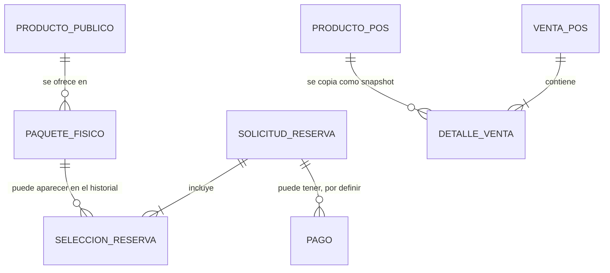

# Requerimientos de datos de EdenFarm

## Alcance y estado

Este documento describe información que el sistema necesitaría conservar y sus relaciones conceptuales. **No es un esquema aprobado**, no elige motor, no define tablas físicas ni genera SQL. No ejecutar ni migrar datos a partir de este documento.

Los pesos `0.850`, `1.250` y `2.300 kg` usados en el prototipo son únicamente ejemplos visuales. No son inventario y no deben importarse, publicarse como disponibilidad real ni alimentar el chatbot.

## Matriz de áreas

| Área | Información requerida | Reglas pendientes |
|---|---|---|
| Catálogo público | Nombre, precio vigente, unidad del precio (`kg` o `pack`), moneda `Bs` y ruta opcional de imagen. Los 17 nombres y precios proporcionados son la fuente autorizada actual. | Confirmar quién podrá actualizar precios. Las imágenes se guardan como archivos en el servidor; MySQL contiene su ruta. No inferir categorías. |
| Paquetes físicos | Identidad única, producto asociado, peso exacto y disponibilidad de cada paquete real. | El inventario todavía no fue entregado. Definir precisión del peso, ciclo de disponibilidad y cuándo se bloquea/libera un paquete. Los estados requieren aprobación. |
| Carrito de reservas | Selección temporal de paquetes concretos, con peso y precio estimado. | Por ahora es estado de interfaz; definir más adelante si sobrevive a una recarga o sesión. No equivale a una reserva confirmada. |
| Solicitud de pedido/reserva | Identificador de solicitud, paquetes seleccionados, datos de contacto requeridos, fecha y estado de la solicitud. | Definir campos de contacto, creación/confirmación, expiración, cancelación, retiro o entrega, fecha/horario y estados. |
| Pago | Referencia y resultado de pago asociados a la solicitud, si el flujo aprobado lo requiere. | Método, pago anticipado, proveedor y datos estrictamente necesarios todavía no están definidos. No almacenar datos de tarjeta. |
| Contenido institucional | Textos e imágenes aprobados para Inicio, Nosotros y Sé socio. | El contenido oficial se proporcionará más adelante. Definir si se administra desde datos o permanece como contenido del frontend. No publicar condiciones de socios no aprobadas. |
| Chatbot determinista | Intenciones reconocidas, patrones lingüísticos y fuentes permitidas para responder; puede incluir respuestas controladas si se decide administrarlas en datos. | Definir quién mantiene las reglas y qué información se autoriza para el chatbot. No guardar conversaciones personales por defecto ni responder desde datos de demostración. |
| POS e historial | Productos del POS, stock agregado, ventas, método de pago, fecha, importes y copia histórica de los datos del producto vendido. | Revisar los valores reales que existan en `localStorage`, la moneda de las ventas existentes y la relación —si existe— entre stock del POS y paquetes físicos. No sobrescribir ventas. |

## Relaciones conceptuales

Este diagrama describe relaciones de negocio, no tablas ni claves definitivas:

Una selección puede relacionar una solicitud con varios paquetes concretos. A lo largo del historial, un paquete podría aparecer en intentos distintos si una solicitud se cancela; la regla que impida que tenga más de una reserva activa debe definirse junto con los estados y la concurrencia.

`PRODUCTO_PUBLICO` y `PRODUCTO_POS` se muestran separados intencionalmente. No se ha aprobado que los nuevos productos del catálogo sustituyan o se mapeen automáticamente a los productos usados por el POS. La relación entre ambos y el posible inventario compartido requieren análisis y aprobación.

## Reglas de negocio conocidas

- Los precios públicos son los 17 valores proporcionados en la especificación y se expresan en bolivianos.
- Los productos por kilogramo se cotizan con la fórmula `precio por kg × peso exacto del paquete`.
- Para el prototipo se redondea el precio de cada paquete a dos decimales y luego se suman los importes mostrados. La regla definitiva de redondeo debe confirmarse antes de integrar pagos.
- Hamburguesa está cotizada por pack; no se le aplica la fórmula por kilogramo sin definir su presentación.
- El carrito se vaciará después de una confirmación de pago exitosa. El pago y la reserva aún no están conectados.
- Los paquetes de demostración no representan existencia, reserva ni disponibilidad real.
- El POS conserva sus modelos, datos mock y ventas históricas mientras no se apruebe un mapeo separado.

## Decisiones necesarias antes del modelo físico

1. Entregar el inventario de paquetes reales, con producto y peso exacto por paquete.
2. Definir si reservas y POS comparten inventario o si sus existencias son independientes.
3. Definir contacto requerido, confirmación, expiración, cancelación, entrega/retiro y pago.
4. Confirmar la regla de redondeo monetario para precios de paquetes y totales.
5. Confirmar la presentación de Hamburguesa y si su precio por pack depende del peso.
6. Entregar contenidos e imágenes institucionales y de socios autorizados.
7. Definir qué respuestas puede dar el chatbot, quién administra sus intenciones y qué servicios de consulta podrá usar.
8. Revisar/exportar los productos y ventas locales antes de decidir cualquier migración. El `localStorage` actual es local por navegador y no representa un inventario centralizado.
9. Elegir el motor y aprobar el modelo físico de datos. La mención previa de MySQL Workbench no sustituye esta aprobación; el esquema SQL que ya existe sigue siendo una propuesta previa no aprobada.
